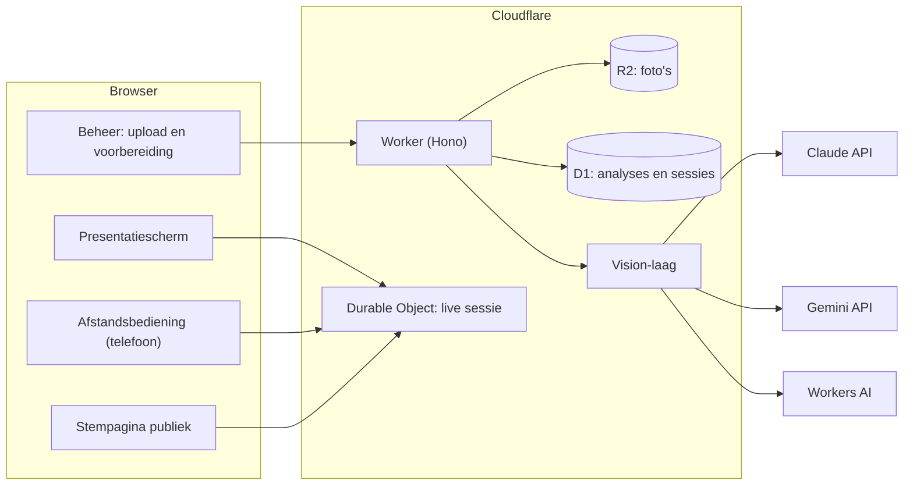

# vakantieman: ontwerp

Versie 0.1, 12 november 2026. Status: ontwerp. Er is nog geen code.

## 1. Doel

Een demo voor awarenesssessies en keynotes. Het publiek probeert te raden waar Wouter is op een selfie. Daarna laat de tool zien dat een beeldmodel de plek wel kan afleiden, en welke details dat mogelijk maakten. De clou van de sessie: die details zijn te verbergen.

## 2. Uitgangspunten

1. **Alleen eigen selfies.** De demo gebruikt uitsluitend foto's van Wouter zelf, nooit van anderen. De enige locatie die wordt onthuld is die van de persoon op de foto.
2. **Gesloten gereedschap.** Privé-repo, niet gepubliceerd. Uploaden, beheer en bediening zitten achter een inlog. Er is geen open uploadpagina.
3. **Geen metadata.** Foto's worden vóór het uploaden in de browser opnieuw gecodeerd, waardoor EXIF en GPS verdwijnen. De tool werkt dus alleen met wat te zien is, en het publiek kan dat controleren.
4. **Instelbaar detailniveau.** Per foto stel je in hoe precies de onthulling mag zijn: land, stad, wijk of straat. Bij foto's van thuis kies je bewust een grof niveau.
5. **Verwisselbaar model.** Claude, Gemini en Cloudflare Workers AI zitten achter één interface. Wisselen is een instelling, geen herbouw.
6. **Altijd terug te rollen.** Alles staat op GitHub. Elke werkende fase krijgt een tag.
7. **Betrouwbaar op het podium.** Analyses worden vooraf opgeslagen. De demo mag niet afhangen van wifi of een externe API.

## 3. De voorstelling

1. **Raadronde.** De selfie staat op het scherm. Het publiek scant een QR-code en tikt op de eigen telefoon een plek aan op een kaart. De stemmen verschijnen live als puntjes op de kaart. Meestal liggen ze verspreid en ver ernaast.
2. **De analyse.** De tool legt de aanwijzingen één voor één bloot als kaders op de foto, elk met een korte uitleg. Bij elke aanwijzing verschuift de kandidatenlijst en vliegt de kaart verder in.
3. **De onthulling.** De pin valt, met afstandsringen. Het scherm toont de echte plek en drie cijfers: de mediaan van de afstanden van het publiek, de dichtstbijzijnde gok in de zaal en de afstand van de tool.
4. **De les.** Een lijst met wat er verklapt werd, met per punt hoe je het voorkomt.
5. **Maak het onzichtbaar.** Dezelfde selfie, maar met de lekkende details weggevaagd. De tool wordt onzeker of zit ernaast. Dat bewijst dat het te voorkomen is.

Wouter bedient dit vanaf zijn telefoon (afstandsbediening); het publiek ziet het presentatiescherm.

## 4. Architectuur



| Onderdeel | Keuze |
|---|---|
| Taal | TypeScript |
| Routes op de Worker | Hono |
| Frontend | Vite met gewone TypeScript, geen framework |
| Kaart | MapLibre GL JS met OpenFreeMap-tegels |
| Foto's | R2 (privé, alleen via de Worker na inlog) |
| Analyses en sessies | D1 |
| Live sessie (stemmen en synchronisatie van de schermen) | Durable Object met SQLite-opslag en WebSockets |
| Toegang | Cloudflare Access, plus controle van de Access-JWT in de Worker zelf |
| Deploy | GitHub Actions met wrangler, op tag of push naar `main` |
| Tests | Vitest |

Geplande indeling van de repo:

```
vakantieman/
  README.md
  docs/ONTWERP.md
  docs/bench/            resultaten van de modelvergelijking
  src/worker/            routes, Durable Object, vision-laag
  src/web/               beheer, presentatie, afstandsbediening, stempagina
  scripts/bench.ts       vergelijkt modellen op de testfoto's
  migrations/            D1-migraties
  wrangler.jsonc
  .github/workflows/deploy.yml
```

## 5. Beeldanalyse en wisselbare modellen

Alle modellen zitten achter één interface:

```ts
interface VisionProvider {
  id: "claude" | "gemini" | "workers-ai" | "mock";
  analyze(input: {
    image: Uint8Array;
    mime: string;
    width: number;
    height: number;
    revealLevel: "country" | "city" | "district" | "street";
  }): Promise<Analysis>;
}
```

Instellingen (omgevingsvariabelen): `VISION_PROVIDER`, `VISION_MODEL` en `VISION_FALLBACK`. De provider `mock` geeft een vaste, voorbeeldanalyse terug, zodat de schermen en de presentatie gebouwd kunnen worden voordat er API-sleutels zijn.

### Gemeenschappelijk resultaat

Elke adapter levert hetzelfde gestructureerde resultaat op:

- `summary`: korte samenvatting van de redenering.
- `clues[]`: aanwijzingen met `id`, `category` (bijvoorbeeld bebording, architectuur, begroeiing, terrein, infrastructuur, voertuigen, taal, zon en schaduw, overig), `description`, `box` (genormaliseerd 0 tot 1, `[x1, y1, x2, y2]`), `confidence` en `leak_advice` (hoe je dit voorkomt).
- `candidates[]`: kandidaatplaatsen met `place`, `country`, `lat`, `lon`, `confidence`, `reasoning` en `supporting_clue_ids`.
- `overall_confidence`.

De adapters rekenen coördinaten van het model om naar dit gemeenschappelijke formaat. Daarna kapt de Worker het resultaat af op het ingestelde detailniveau van de foto: coördinaten worden afgerond en plaatsnamen die preciezer zijn dan toegestaan worden verwijderd, vóórdat er iets wordt opgeslagen of getoond.

### Verschillen tussen de providers

| | Claude API | Gemini API | Workers AI |
|---|---|---|---|
| Gestructureerde uitvoer | `output_config.format` met JSON-schema | `response_format` met JSON-schema, ook met afbeeldingen | afhankelijk van het model |
| Kaders op de foto | pixelcoördinaten `[x1, y1, x2, y2]` in de door Claude verwerkte afbeelding | `box_2d` als `[ymin, xmin, ymax, xmax]`, geschaald naar 0 tot 1000 | niet vooraf te garanderen, eerst testen |
| Beeldlimieten | 10 MB per afbeelding (base64), maximaal 8000 x 8000 px; hoge-resolutietier (Claude 4.7 en nieuwer) tot 2.576 px lange zijde | 20 MB per verzoek inline, daarboven de Files API | afhankelijk van het model |
| Kosten | betaald, per token | gratis laag voor onder meer de flash-lite-modellen; de limieten staan niet op de prijspagina | 10.000 neurons per dag gratis |
| Gegevensgebruik | voorwaarden controleren bij het aanvragen van de sleutel | gratis laag: gegevens worden gebruikt om producten te verbeteren | draait op Cloudflare, voorwaarden controleren |

Uit de documentatie volgen twee ontwerpkeuzes:

- **Vooraf verkleinen.** De foto wordt in de browser verkleind tot maximaal 2.576 px aan de lange zijde. Zo zijn de afmetingen bekend en kloppen de kaders. Claude raadt dit zelf aan, omdat het anders de afbeelding stilzwijgend verkleint en de pixelcoördinaten verschuiven.
- **Gevoeligheid per foto.** Elke foto heeft `sensitivity` `public` of `private`. Foto's van thuis zijn `private` en gaan alleen naar providers waarvan de voorwaarden gebruik voor modeltraining uitsluiten. De gratis laag van Gemini is daardoor alleen toegestaan voor `public` foto's.

### Modelvergelijking

`npm run bench` laat alle ingestelde providers en modellen dezelfde testfoto's analyseren. Elke testfoto heeft een bekende plek. Het script schrijft een tabel naar `docs/bench/` met per model de afstandsfout, de snelheid en de kosten. De providerkeuze (en de keuze tussen bijvoorbeeld `claude-sonnet-5-5` en `claude-opus-5-5`) maken we op basis van die cijfers, niet op aannames.

### Opslaan van analyses

Elke analyse wordt per foto, variant (`original` of `masked`), provider en model in D1 bewaard. De presentatie gebruikt altijd de opgeslagen analyse. Alleen de knop "nieuwe selfie" doet een live analyse, met de voorbereide set als terugval.

## 6. Gegevensmodel (D1)

- `photos`: `id`, `r2_key`, `label`, `true_lat`, `true_lon`, `true_place`, `reveal_level`, `sensitivity`, `width`, `height`, `created_at`.
- `analyses`: `id`, `photo_id`, `variant`, `provider`, `model`, `result_json`, `latency_ms`, `input_tokens`, `output_tokens`, `created_at`.
- `sessions`: `id`, `code`, `photo_id`, `analysis_id`, `state`, `started_at`, `ended_at`, `summary_json`.

De losse stemmen van het publiek leven alleen in het Durable Object. Na afloop blijft alleen een samenvatting over (aantal stemmen, mediaan van de afstanden, afstand van de dichtstbijzijnde gok). De losse stemmen worden gewist.

## 7. Routes

Publiek:

- `GET /v/:code`: stempagina.
- `POST /api/vote/:code`: één stem (lat, lon). Alleen als de ronde open is, met een zachte limiet per apparaat (token in de browser) en een limiet per sessie. Er worden geen IP-adressen opgeslagen. Eventueel Cloudflare Turnstile.

Achter inlog:

- `GET /admin`: beheer en voorbereiding.
- `GET /present/:code`: presentatiescherm.
- `GET /control/:code`: afstandsbediening.
- `POST /api/photos`: upload van een al in de browser opnieuw gecodeerde foto.
- `POST /api/photos/:id/analyze`: analyse starten (provider en variant als parameter).
- `GET /api/analyses/:id`: opgeslagen analyse ophalen.
- `POST /api/sessions`: sessie aanmaken en code genereren.
- `GET /ws/:code`: WebSocket naar het Durable Object.

## 8. Beveiliging en privacy

- **Toegang:** Cloudflare Access (gratis tot 50 gebruikers) voor alle beheer- en bedieningsroutes. De Worker controleert daarnaast zelf de `Cf-Access-Jwt-Assertion`, zodat een foutieve Access-instelling niet tot open routes leidt. De documentatie die ik heb gelezen bevestigt Access voor workers.dev-adressen; voor een eigen domein controleren we dit bij de inrichting.
- **Geheimen:** API-sleutels staan als Worker-secrets (`wrangler secret`) en in GitHub Actions-secrets, nooit in de repo. Lokaal staan ze in `.dev.vars`, dat in `.gitignore` staat.
- **Foto's:** privé in R2, alleen te lezen via de Worker na de inlogcontrole.
- **Metadata:** de browser codeert elke foto opnieuw via een canvas (en verkleint tegelijk). Daarbij verdwijnen EXIF en GPS vanzelf. De Worker weigert uploads die toch metadata bevatten.
- **Waarom in de browser:** het gratis Workers-plan staat maar 10 ms CPU-tijd per verzoek toe, dus beeldbewerking gebeurt niet in de Worker.
- **Bewaartermijn:** foto's en analyses zijn van Wouter zelf en blijven bewaard tot hij ze verwijdert. Er komt een knop "alles wissen". Stemmen van het publiek worden na afloop van de sessie samengevat en gewist (eventueel via een cron-trigger).
- **Gevoeligheid:** zie hierboven, `private` foto's gaan alleen naar geschikte providers.

## 9. Kaart

MapLibre GL JS met OpenFreeMap (stijl `https://tiles.openfreemap.org/styles/liberty`). De publieke instance is gratis, vraagt geen sleutel of registratie en heeft volgens de website geen limiet op kaartweergaven. De bronvermelding is verplicht en MapLibre voegt die zelf toe. Mocht de afhankelijkheid van een externe tegelserver een probleem worden, dan is de terugval een eigen PMTiles-bestand in R2. Voor het podium komt er daarnaast een vooraf gemaakte statische kaartweergave per foto.

## 10. Fasering

Elke fase eindigt met een werkende versie, een commit en een tag. Terugrollen is `git checkout <tag>` en een nieuwe deploy, of `wrangler rollback`.

| Fase | Tag | Inhoud | Klaar als |
|---|---|---|---|
| 0 | `v0.0-ontwerp` | README, `.gitignore`, dit ontwerp | staat op GitHub |
| 1 | `v0.1` | Upload (opnieuw gecodeerd in de browser), R2 en D1, vision-interface met adapters voor Claude, Gemini en `mock`, analyse-JSON met kaders en kandidaten, kaartweergave, bench-script, Access | een selfie levert een opgeslagen analyse op die op de kaart staat, en de bench vergelijkt twee modellen |
| 2 | `v0.2` | Presentatiescherm en afstandsbediening via het Durable Object, stap-voor-stap onthulling met kaders op de foto, kaartanimatie, detailniveau per foto | je kunt een voorbereide sessie vanaf je telefoon doorlopen |
| 3 | `v0.3` | Raadronde: QR-code, stempagina, live stemmen op de kaart, scorebord | een testgroep kan stemmen en het scorebord klopt |
| 4 | `v0.4` | Lekkenlijst met tips, "maak het onzichtbaar" (vervagen van de kaders en heranalyse als variant `masked`) | de voor-en-nawissel werkt op minstens drie testfoto's |
| 5 | `v0.5` | Terugval zonder netwerk, wissen en cron-opruiming, adapter voor Workers AI, definitieve providerkeuze op basis van de bench | de demo draait zonder live API-aanroepen |

Mogelijke uitbreidingen na fase 5: een verificatiestap met OpenStreetMap-gegevens (klopt de kandidaat met wat er in de omgeving staat), zonnestand en schaduw als extra aanwijzing, een Engelstalige interface.

## 11. Wat ik later van je nodig heb

Nog niets om nu te regelen; dit komt aan bod zodra we aan fase 1 beginnen.

1. **Cloudflare-account** dat van Wouter zelf is (`mail@wouterslotboom.nl` of `mail@wwwouter.nl`, niet dat van Stijn), met een workers.dev-subdomein of een eigen domein.
2. **Cloudflare API-token** voor deploys (rechten voor Workers, R2, D1 en Durable Objects), samen met het account-ID, als GitHub Actions-secrets: `CLOUDFLARE_API_TOKEN` en `CLOUDFLARE_ACCOUNT_ID`. Het is niet zeker dat ik vanuit mijn werkomgeving rechtstreeks naar Cloudflare kan deployen. Deployen via GitHub Actions past ook bij je wens dat alles via GitHub loopt.
3. **Zero Trust inschakelen** in dat account (gratis plan) voor Access.
4. **API-sleutels** voor de modellen die we willen vergelijken: Anthropic (`ANTHROPIC_API_KEY`) en Google AI Studio (`GEMINI_API_KEY`). Workers AI heeft geen sleutel nodig, alleen een koppeling in de Worker.
5. **Testfoto's:** 10 tot 15 selfies met een bekende plek, gevarieerd (binnen en buiten, stad en dorp, bekend en onbekend, ook een paar van thuis), met per foto de plek en het gewenste detailniveau.

## 12. Open beslissingen

- Welk Cloudflare-account.
- Eigen domein of workers.dev.
- Providerkeuze, na de bench.
- Welk detailniveau je bij thuisfoto's wilt.
- Of R2 activeren een betaalmethode vraagt: dat vermeldt de prijspagina niet, dus dat controleren we bij het activeren.

## 13. Risico's en beperkingen

- **Het model kan ernaast zitten.** Het ontwerp toont daarom zekerheid en meerdere kandidaten. Dat is ook een eerlijker verhaal voor de zaal.
- **Kaders zijn niet altijd nauwkeurig.** Claude waarschuwt zelf dat ruimtelijk redeneren beperkingen heeft en dat verkleinen kleine details aantast. We controleren de kaders visueel en kunnen voor kleine details uitsnijden en opnieuw analyseren.
- **Limieten van de gratis laag van Gemini zijn onbekend.** De prijspagina noemt ze niet. We lezen ze af in Google AI Studio bij het aanvragen van de sleutel. De modelnamen op die pagina controleren we op dat moment ook.
- **Gegevensgebruik door gratis diensten** (Gemini): zie `sensitivity`.
- **Gratis Cloudflare-limieten:** 100.000 verzoeken per dag voor Workers en een CPU-limiet van 10 ms per verzoek. Voor deze demo ruim voldoende, zolang de beeldbewerking in de browser blijft.
- **Wifi op het podium:** analyses staan vooraf in D1 en er komt een terugval zonder netwerk (fase 5).

## 14. Bronnen

De limieten en gegevens hierboven zijn gelezen op 12 november 2026 en kunnen wijzigen.

- Cloudflare Workers, limieten: https://developers.cloudflare.com/workers/platform/limits
- Durable Objects, prijzen en gratis laag: https://developers.cloudflare.com/durable-objects/platform/pricing
- D1, prijzen: https://developers.cloudflare.com/d1/platform/pricing/
- R2, prijzen: https://developers.cloudflare.com/r2/pricing/
- Workers AI, prijzen: https://developers.cloudflare.com/workers-ai/platform/pricing/
- Workers AI, modellen: https://developers.cloudflare.com/workers-ai/models/
- Cloudflare Access: https://www.cloudflare.com/en-gb/products/zero-trust/access
- Access voor Workers (workers.dev): https://developers.cloudflare.com/workers/configuration/routing/workers-dev/
- Gemini API, prijzen: https://ai.google.dev/gemini-api/docs/pricing
- Gemini API, beeldbegrip: https://ai.google.dev/gemini-api/docs/image-understanding
- Claude API, vision: https://platform.claude.com/docs/en/build-with-claude/vision
- Claude API, coördinaten in afbeeldingen: https://platform.claude.com/docs/en/build-with-claude/vision-coordinates
- Claude API, gestructureerde uitvoer: https://platform.claude.com/docs/en/build-with-claude/structured-outputs
- OpenFreeMap: https://openfreemap.org


## 15. Zoals gebouwd (afwijkingen van dit ontwerp)

- **Twee Workers** in plaats van één: `vakantieman` (achter Cloudflare Access) en `vakantieman-vote` (openbaar). Access op een workers.dev-adres dekt de hele Worker, en het publiek mag niet inloggen. De stem-Worker heeft alleen een Durable Object-binding (via `script_name`), geen D1 of R2.
- **Analyse via de browser:** de browser stuurt de afbeelding als base64 mee, zodat de Worker niets hoeft te coderen (CPU-limiet gratis plan). Het ruwe modelantwoord wordt nooit bewaard; eerst volgt beperking tot het detailniveau.
- **Goedgekeurde analyse:** een sessie gebruikt alleen goedgekeurde analyses. Verborgen aanwijzingen en kandidaten komen niet in het sessiescript.
- **Sessiekamer:** één Durable Object per code. Stemmen staan in SQLite van de kamer en worden bij afsluiten gewist; alleen een samenvatting gaat naar D1. Meldingen over nieuwe stemmen worden per 700 ms gebundeld.
- **Routes:** `/api/photos`, `/api/analyses`, `/api/sessions` (incl. `/refresh`, `/script`), `/api/admin/wipe`, `/ws/:code` (Origin-controle), op de stem-Worker `/v/:code`, `/api/vote/:code` en `/api/vote/:code/status`.
- **Offline-speler:** eigen SVG-kaart (Mercator) in plaats van MapLibre, zodat het één los bestand blijft; geen live stemmen.
- **Opruiming:** dagelijkse cron sluit live sessies na 12 uur en niet gestarte sessies na 14 dagen. "Alles wissen" vraagt de tekst ALLES WISSEN.
- **Workers AI:** de provider ondersteunt de binding, maar `ai` staat bewust niet in `wrangler.jsonc`: lokaal vraagt die binding om inloggen. Voeg `"ai": { "binding": "AI" }` toe als je Workers AI wilt gebruiken.
- **Tags:** niet te pushen vanuit de ontwikkelomgeving; zie CHANGELOG.md.
